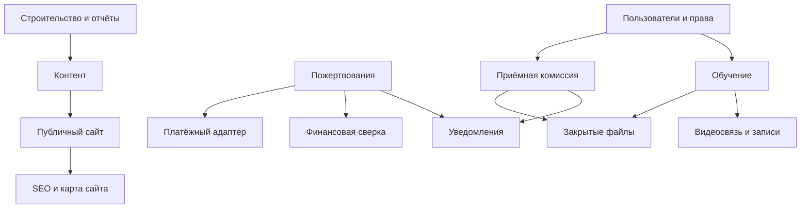

# Карта системы

Статус: локальная первая версия. Основание — приоритет пользователя: информационный сайт, SEO и кирпичики будущей системы.

## Модули и границы
| Модуль | Вход → результат | Владеет данными | Зависимости / отказ | Этап |
|---|---|---|---|---|
| site | исходные страницы → готовый HTML | навигация, шаблоны | ошибка сборки не меняет опубликованную версию | реализован |
| content | проверенные тексты → публикация | страницы, версии, авторство | сейчас файлы; позже CMS через адаптер | реализован в файлах |
| seo | метаданные и домен → title, canonical, sitemap | метаданные страниц | без домена только закрытый предпросмотр | реализован |
| construction | этапы, документы → журнал работ | этапы, фото, сметы | отсутствие данных показано честно | контракт |
| donations | намерение помочь → подтверждённая операция | сборы, пожертвования, назначения | таймаут: статус ожидает сверки; не списывать повторно | контракт |
| reporting | подтверждённые операции → отчёт | сверки, публикации отчётов | последний подтверждённый отчёт остаётся доступен | контракт |
| identity | вход → сессия и права | Account, User, Membership | закрытые функции недоступны; сайт работает | контракт |
| admissions | заявление → решение | заявления, статусы | сбой: заявка не считается отправленной | контракт |
| learning | группа и задания → учебный процесс | курсы, группы, работы, результаты | материалы доступны при отказе видеосвязи | контракт |
| files | разрешённая загрузка → закрытый объект | файлы, сроки хранения, разрешения | ссылка не публичная; ошибка с повтором | контракт |
| video | занятие → подключение, запись | встречи, ссылки на записи | запасная ссылка; сайт и задания работают | контракт |
| notifications | событие → доставка | попытки и подтверждения | очередь, повторы; основной сценарий работает | контракт |
| billing | договор обучения → платёж | начисления за обучение | отдельно от пожертвований | контракт |
| onboarding | приглашение → членство | приглашения | без публичной регистрации в MVP | контракт |
| platform-admin | запрос поддержки → аудит | служебные действия | нет скрытого обхода прав | контракт |
| usage | событие → использование лимитов | счётчики | не мешает чтению публичного сайта | контракт |
| data-export | авторизованный запрос → выгрузка/удаление | задания обработки запросов | очередь и уведомление ответственного | контракт |

## Технический подход
Статический публичный сайт; Python — сборка. Будущий backend: модульный монолит Python/FastAPI, PostgreSQL, отдельный worker для уведомлений и длительных задач. Это предложение, зависимости backend не установлены и сервер не реализован.

Внешние сервисы только через adapters: таймаут, повторы с паузой, контроль идемпотентности, понятное состояние отказа. Платёжные вебхуки проверяют подпись, сумму, валюту, получателя; повторная доставка не создаёт вторую операцию. Алерты ответственному и /health появятся с сервером.

## Пользователи и данные — будущий контракт
Account — организация; User связан через Membership. Во всех принадлежащих организации записях account_id, фильтрация в общем слое, отдельная проверка доступа к объекту. Роли: owner, editor, finance, admissions, teacher, student; parent только при появлении несовершеннолетних. Суперадминистратор — отдельное полномочие с аудитом, не открытый маршрут.

Plan, limits, features и check_limit централизованы; коммерческие тарифы не запускаются. Файлы изолированы по account_id. Секреты шифруются, журнал действий обязателен для закрытой части. Выгрузка и сроки удаления проектируются до приёма документов.

## Внешние сервисы
Сейчас нет API, аналитики, внешних шрифтов и трекеров. Платёжный провайдер, видеосервис, почта, файловое хранилище и CMS не выбраны; цены и лимиты фиксируются перед подключением. Финансовые события и документы не отправлять в сторонние сервисы по умолчанию.
